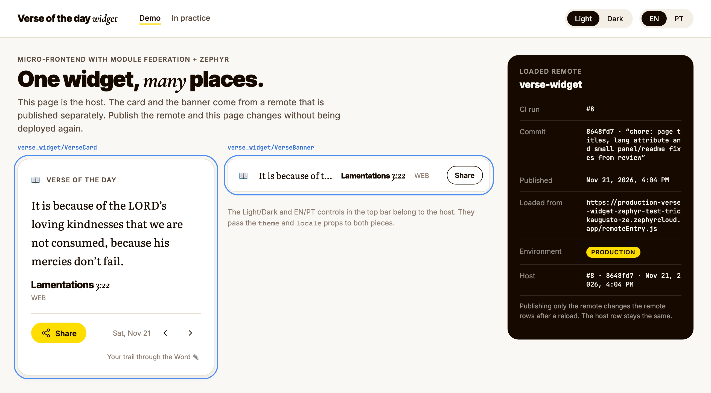
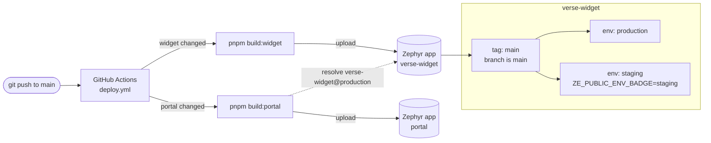
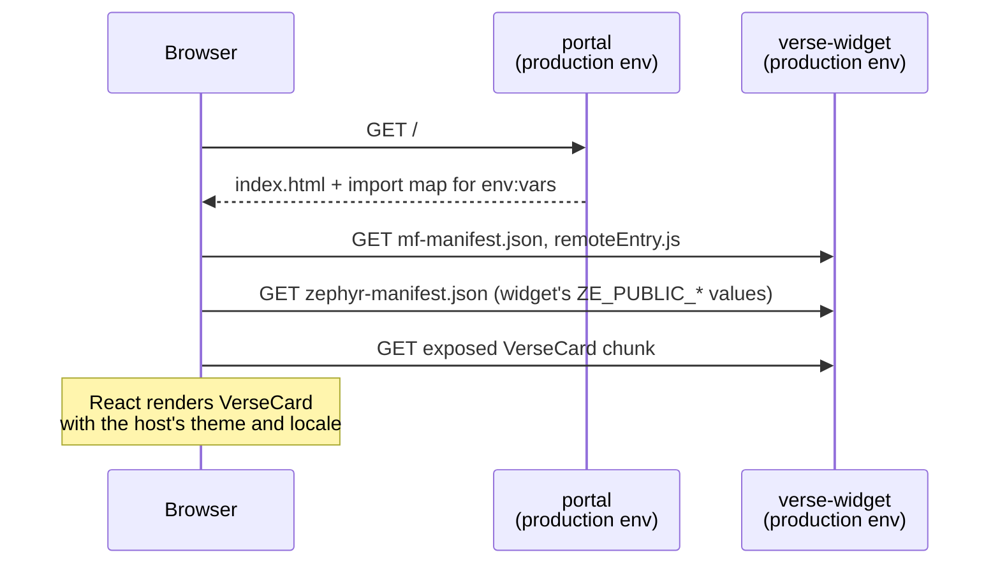
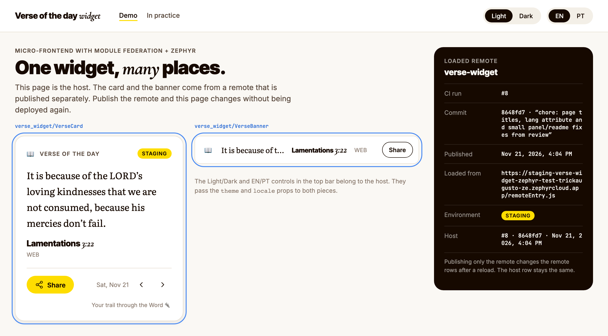

# Verse of the day widget, a micro-frontend on Zephyr Cloud

A "verse of the day" widget built as a **Module Federation remote** and consumed by a separate **host**, both deployed with **[Zephyr Cloud](https://zephyr-cloud.io)** on its default (managed) cloud.

The point of the project: the host never hardcodes where the widget lives. Zephyr resolves it at build time to an **environment URL**, so publishing only the widget updates every host that uses it, with no host redeploy. Environments, per-environment variables and rollbacks are pointer moves, not rebuilds.



| | URL |
|---|---|
| Portal, production | https://production-portal-zephyr-test-trickaugusto-ze.zephyrcloud.app/ |
| Portal, staging | https://staging-portal-zephyr-test-trickaugusto-ze.zephyrcloud.app/ |
| Widget, production | https://production-verse-widget-zephyr-test-trickaugusto-ze.zephyrcloud.app/ |
| Widget, staging | https://staging-verse-widget-zephyr-test-trickaugusto-ze.zephyrcloud.app/ |

## What it does

**The widget (`apps/verse-widget`, remote `verse_widget`)** exposes three modules:

| Module | What it is |
|---|---|
| `./VerseCard` | Card with the verse of the day, Share (Web Share API, clipboard fallback) and previous/next day. |
| `./VerseBanner` | One-line version of the same verse. |
| `./meta` | Build metadata (commit, CI run, build time), shown by the host. |

Both UI pieces take the same props, which are the whole host ↔ remote contract:

| Prop | Values | Default |
|---|---|---|
| `theme` | `"light"` \| `"dark"` | `"light"` |
| `locale` | `"en"` \| `"pt-BR"` | `"en"` |

`locale` switches the whole widget: labels, date format and Bible translation (World English Bible in English, Bíblia Livre in Portuguese). The verse is picked from a fixed list of 30 references by the local calendar day, so everyone sees the same verse on the same day. No backend.

**The portal (`apps/portal`, host)** has a Light/Dark and EN/PT switch that drives both pieces, an "In practice" tab with an example church page, and a **"Loaded remote" panel** showing which widget build is running, where it was loaded from and which environment served it, next to the host's own build. That panel is how you see, in the browser, that the widget changed while the host did not.

If the widget can't be loaded, each slot shows a fallback message and the rest of the page keeps working.

## Architecture

**Deploy:** CI builds only what changed. The portal resolves the widget at build time to an environment URL, never a fixed version.



**Runtime:** the deployed portal loads the widget from the widget's environment, so a new widget build shows up on the next page load.



How the host finds the remote:

1. The portal's Module Federation config only has a **localhost URL, for local dev**:
   ```ts
   remotes: { verse_widget: 'verse_widget@http://localhost:3001/mf-manifest.json' }
   ```
2. Its `package.json` declares the dependency for Zephyr:
   ```json
   "zephyr:dependencies": { "verse_widget": "verse-widget@production" }
   ```
   Left side: the same key as in `remotes`. Right side: the Zephyr application (`name` of the widget's `package.json`) and a selector (environment, tag or version).
3. On build, `withZephyr()` asks Zephyr where `verse-widget@production` is and writes that URL into the bundle. The build log shows it:
   ```
   ZEPHYR   Resolved remotes:
   ZEPHYR     verse_widget → https://production-verse-widget-zephyr-test-trickaugusto-ze.zephyrcloud.app/remoteEntry.js
   ```
4. That is the **environment** URL, not a fixed version URL (default `dependencyUrlMode: 'selector'`). When the environment points to a newer widget build, the already-deployed portal loads it on the next page load.

The portal imports remote modules with `React.lazy(() => import(...))` inside an error boundary. See "Problems encountered" for why the dynamic import matters.

## Repository layout

```
apps/
  verse-widget/          remote
    rsbuild.config.ts    Module Federation (name verse_widget, exposes) + withZephyr()
    src/
      components/        VerseCard, VerseBanner, Icons (tests next to each file)
      hooks/             useShare, useVerseView
      lib/               verse selection, i18n, env badge, build meta
      data/              references and verse text (en, pt-BR)
      styles/            design tokens and widget styles
      types/             shared types and build-time globals
      App.tsx            standalone page, shown when the widget URL is opened directly
  portal/                host
    rsbuild.config.ts    Module Federation (remotes) + withZephyr()
    package.json         "zephyr:dependencies"
    src/
      components/        LoadedRemotePanel, RemoteSlot, TopBar, Segmented
      pages/             DemoPage, ChurchPage
      lib/               runtimeInfo (reads the loaded remote URL from the MF runtime), hostMeta
      types/             hand-written types for the remote's modules
.github/workflows/deploy.yml
```

Stack: Node 24, pnpm workspaces, Rsbuild 1.x, `@module-federation/rsbuild-plugin`, `zephyr-rsbuild-plugin`, React 19, TypeScript, Vitest + Testing Library. Scaffolded from Zephyr's official `react-rsbuild` template (`npx create-zephyr-apps --template react-rsbuild`).

## Run locally

```bash
corepack enable pnpm
pnpm install
pnpm dev     # widget on :3001, portal on :3000 (Zephyr disabled in dev)
pnpm test
ZE_DISABLED=true pnpm build   # production build without deploying
```

`pnpm dev` runs with `ZE_DISABLED=true`, so local development never publishes and needs no login. A plain `pnpm build` deploys (see below).

## Deploy

**From your machine.** Build the remote first, then the host:

```bash
pnpm build:widget   # first run opens the browser to log in to Zephyr
pnpm build:portal
```

Each build prints its version URL. The first run must be in an interactive terminal (browser login); the token is then stored in `~/.zephyr`.

**From CI** (`.github/workflows/deploy.yml`), on every push to `main`:

- `dorny/paths-filter` checks which app changed. Only changed apps are tested and rebuilt.
- The portal job waits for the widget job (it resolves the widget at build time), and still runs when the widget was skipped.
- Auth is a Zephyr **CI token** (Settings → Tokens → CI Tokens), stored as the repo secret `ZEPHYR_CI_TOKEN` and passed to the build as `ZE_CI_TOKEN`. `ZE_FAIL_BUILD=true` makes a Zephyr failure fail the job instead of silently skipping the deploy.
- `fetch-depth: 0`, since Zephyr reads git metadata (branch, commit, repo, org) to identify the application.

## Zephyr setup (dashboard)

The remote must be built and must have an environment before the host can resolve it.

**verse-widget**
- Tag `main`: condition *branch is `main`*.
- Environment `production` → tag `main`.
- Environment `staging` → tag `main`, variable `ZE_PUBLIC_ENV_BADGE=staging`.

**portal**
- Tag `main`, environments `production` and `staging` → tag `main`.
- In `staging`, dependency override: `verse_widget` → environment `staging` of `verse-widget`.

### What that gives you

- **Independent remote deploy.** Change only the widget, push: the Actions run skips the portal job, and the production portal shows the new widget on reload. The panel's remote commit changes; the host row doesn't.
- **Same build, different config.** The widget reads `process.env.ZE_PUBLIC_ENV_BADGE`. Zephyr injects each environment's value at serve time, so the staging URL shows a "Staging" chip and production doesn't, from the same build.
- **Remote override per environment.** The portal's staging environment serves the same portal build as production but loads the widget's staging environment. Inside it, the widget reads the widget's own staging variables (the portal's HTML gets an import map pointing `env:vars:verse-widget…` to the widget environment's `zephyr-manifest.json`).

  

- **Rollback.** Redeploying the previous version of the widget's `production` environment from the dashboard brings the old widget back in every host on reload, with no build. The next CI build on `main` moves it forward again, since `production` follows the `main` tag.

## Problems encountered

- **A remote that reads `ZE_PUBLIC_*` becomes an async module.** Zephyr rewrites `process.env.ZE_PUBLIC_ENV_BADGE` into `import("env:vars:verse-widget.zephyr-test.trickaugusto", { with: { type: "json" } })`, which makes the exposed `./VerseCard` async. An early portal build that imported the remote statically (`import VerseCard from 'verse_widget/VerseCard'`) received a Promise instead of a component once that widget version was published, and crashed with React error #130. The current portal uses `React.lazy(() => import(...))` and works. Reproduced locally: the old host code with the Zephyr-built widget fails; with a widget built without Zephyr, it works. Takeaway: load remotes dynamically.
- **`rsbuild dev` fails before the first login.** With `withZephyr()` in the config, the dev server stops with "Zephyr authentication is missing, invalid, or expired". Fixed by running `dev` with `ZE_DISABLED=true`.
- **Login needs an interactive terminal.** In a non-interactive shell the first build fails with "Interactive login is unavailable".
- **Template leftovers.** The `react-rsbuild` template ships an unused `consumer/module-federation.config.ts` with names and a port that differ from the real config, and pins `zephyr-rsbuild-plugin` to `latest`. I removed the file and pinned `^1.8.0`.
- **Newer TypeScript in the editor** (TS 7) flagged CSS side-effect imports and `process`. Fixed with Rsbuild's client types and a small `process.env` declaration.

## Feedback on Zephyr

What worked well:

- **First deploy in minutes.** `pnpm build`, browser login, URL printed. No deploy step to configure.
- **The build log explains itself**: "Resolved remotes: verse_widget → &lt;url&gt;" makes the resolution visible.
- **Environment overrides worked the first time**, both `ZE_PUBLIC_*` values and remote overrides, with no rebuild. The remote reading its own environment's variables inside a host is a nice detail.
- **Tags + environments + CI** fit together naturally: CI builds on `main` move `production` forward with no manual promotion.
- **The official agent skills** (`zephyr-core`, `zephyr-module-federation`) were accurate and matched the docs.

What could be better:

- **Document that `ZE_PUBLIC_*` makes a remote async**, and ideally warn in the build log. The env-vars doc says no special imports are needed, but a statically imported remote breaks at runtime, silently, after a remote-only change.
- **`dev` should work before login** (or skip Zephyr in dev by default), since the template's `dev` script fails out of the box.
- **Token names.** Docs, messages and examples mention `ZE_CI_TOKEN`, `ZE_SERVER_TOKEN` and `ZE_SECRET_TOKEN`; the `zephyr-examples` agent guide still uses the server token. One name in all messages would help.
- **Docs show `*.zephyr-cloud.io` URLs**; deployments are served from `*.zephyrcloud.app`.
- **Template:** remove the unused MF config file, pin versions, and consider current Rsbuild/MF majors.

## How this was built (AI-assisted)

I built this with an AI coding agent and kept the decisions, accounts and review on my side. The flow was spec-driven:

1. **Discovery.** I skimmed the Zephyr docs to get the overall picture. Then the agent read the relevant pages and Zephyr's public repos in depth, and we went through the product in conversation: versions, tags, environments, remote resolution, the edge architecture and BYOC.
2. **Brainstorm.** Scope, visual direction and the host/remote contract were decided through questions and browser mockups before any code.
3. **Written design, independently reviewed.** A fresh sub-agent read the design as if it had to build it. It flagged the one real unknown up front: whether a remote's `ZE_PUBLIC_*` values reach it when it runs inside a host. We planned a fallback, and the first deploy showed it works.
4. **Implementation plan.** Tasks with exact interfaces and test cases (TDD), plus a list of failure modes to test explicitly (remote down, share cancelled, invalid props, far-off dates, empty env var).
5. **Execution.**
   - The scaffold (from the official `react-rsbuild` template) and the first deploys ran step by step, with me doing the browser login and the dashboard setup.
   - Then three agents worked in parallel in separate git worktrees (widget, portal, CI), coordinated with [Orca](https://www.onorca.dev). Each had a self-contained spec, ran builds with `ZE_DISABLED=true`, and could not push or deploy. The coordinating agent reviewed and merged their branches.
6. **Verification.** Unit tests, `tsc` on TypeScript 5.9 and 7, local builds, and a headless browser against the deployed URLs. The browser checks caught two layout bugs and drove the root-cause analysis of the async-remote issue described above.

Tools: [Kiro CLI](https://kiro.dev) with Claude as the agent, Zephyr's official [agent skills](https://github.com/ZephyrCloudIO/skills) (`zephyr-core`, `zephyr-module-federation`) to check the setup against Zephyr's own guidance, and Orca for the parallel workers.

Not used: the [Zephyr API MCP](https://docs.zephyr-cloud.io/tools/api-mcp). Tags, environments and rollbacks were done in the dashboard on purpose, to see the product as a user does. Driving them through the MCP would be a natural next step.

## Credits and licenses

- Code: MIT, see [LICENSE](LICENSE).
- English text: [World English Bible](https://ebible.org/engwebp/), public domain.
- Portuguese text: [Bíblia Livre](https://ebible.org/porbr2018/), [CC BY 4.0](https://creativecommons.org/licenses/by/4.0/deed.pt_BR). Attribution is shown in both the card and the banner.
- Visual identity: adapted, with permission, from a Bible-reading app the author works on. No logos are included.
